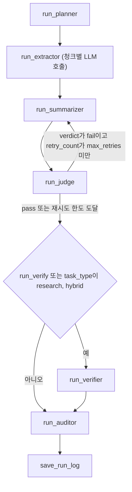
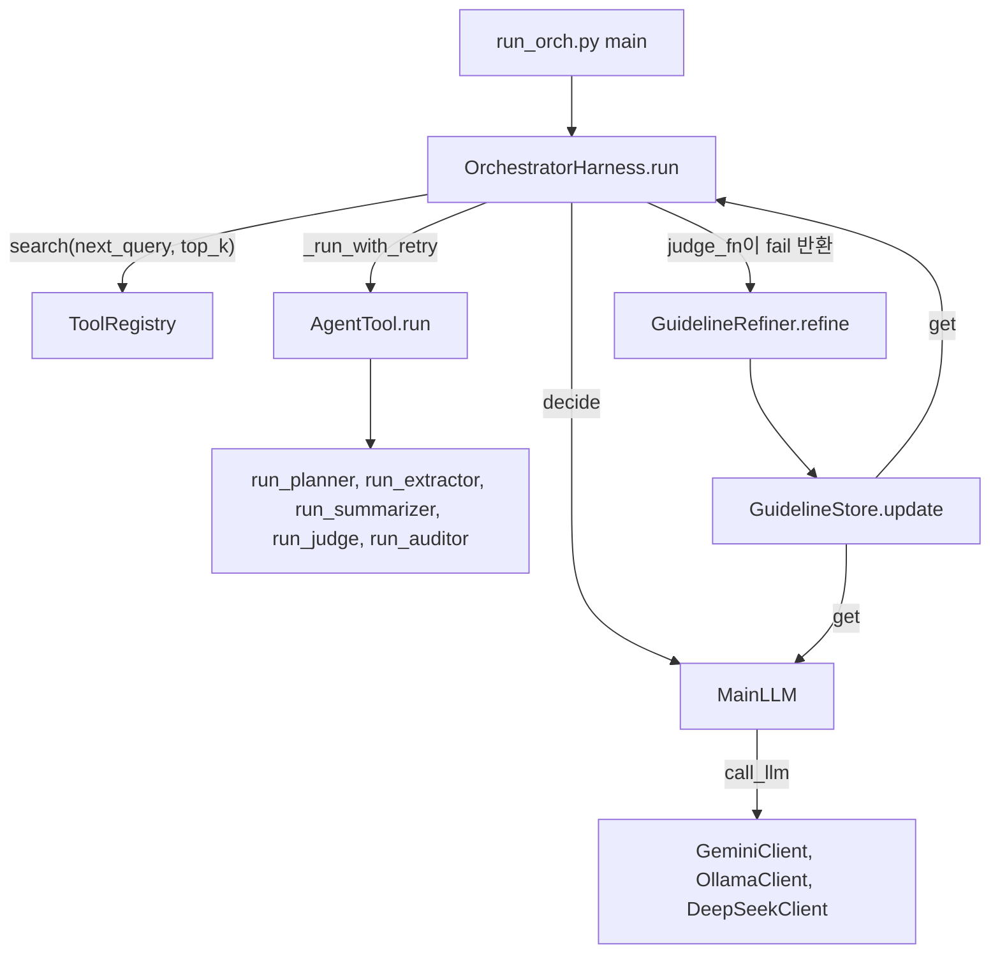

# agent_lab

A small Python lab for LLM agent harnesses: a coverage-checking summarizer built two ways (fixed pipeline and LLM-driven tool orchestration), plus the reusable parts split out into `core/`.

## 한 줄 소개

문서 요약에서 빠진 항목과 근거 없는 문장을 잡아내는 "coverage 에이전트"를 고정 파이프라인과 LLM 오케스트레이션 두 방식으로 만들고, 그 과정에서 나온 재사용 부품을 `core/`로 분리해 가는 실험 저장소이다.

## 무엇을 왜 만들었나

LLM에게 긴 문서를 요약시키면 중요한 항목이 빠지거나 문서에 없는 내용이 섞일 수 있다. 이 저장소의 `experiments/coverage_agent`는 요약을 한 번 생성하고 끝내지 않고, 요약 전에 원문에서 확인해야 할 항목의 체크리스트를 뽑고, 요약 뒤에 그 체크리스트가 얼마나 반영됐는지 판정하고, 부족하면 보완 지시와 함께 다시 쓰게 하는 구조를 실험한다. 마지막에는 감사 단계가 승인, 수정, 사람 검토 중 하나를 결정한다.

두 번째 목적은 개발 방식이다. 코드는 AI 코딩 도구가 작성하고 구조의 방향은 작성자가 정한다는 작업 방식을 `CLAUDE.md`와 `codingforme.md`에 규칙으로 적어 두었다. 실험 코드는 `experiments/`, 검증된 재사용 부품은 `core/`에 두고 의존 방향은 `experiments`에서 `core`로만 흐르게 한다는 규칙이다. 이 저장소는 그 규칙 아래에서 실험이 부품으로 떨어져 나오는 과정을 커밋 3개에 걸쳐 담고 있다.

## 핵심 구조

실험은 같은 노드 함수(`run_planner`, `run_extractor`, `run_summarizer`, `run_judge`, `run_verifier`, `run_auditor`)를 두 가지 방식으로 구동한다. 첫째는 `harness.run_harness`가 순서를 코드로 고정하는 방식이다.



둘째는 `core.orchestrator.OrchestratorHarness`가 매 스텝마다 LLM에게 다음에 쓸 툴을 고르게 하는 방식이다. 노드 함수는 `AgentTool` 서브클래스(`PlannerTool` 등)로 감싸 `ToolRegistry`에 등록한다.



`core/`는 LLM 클라이언트(`core/ai`), 상태와 문서 로더와 JSON 파서(`core/agent`), 툴 기반 클래스와 레지스트리(`core/tool`), 오케스트레이터(`core/orchestrator`), 실행 흐름 뷰어(`core/ui`)로 이루어진다. `core`에는 `experiments`를 import하는 코드가 없다(grep으로 확인).

## 주요 기능

LLM 클라이언트는 `GeminiClient`, `OllamaClient`, `DeepSeekClient` 세 개이고, `core.ai.get_llm`이 이름으로 골라 준다. 세 클라이언트는 `core.ai.base.call_llm` 하나로 같은 방식으로 호출되며, 이때 `guideline` 인자가 있으면 시스템 프롬프트 끝에 `[가이드라인]` 절로 덧붙는다.

문서 입력은 `core.agent.ingest.load_documents`가 폴더의 `.txt`, `.md`, `.pdf`를 읽어 `Document`로 만든다. PDF는 `pdfplumber`가 없으면 건너뛴다.

추출 단계(`experiments/coverage_agent/nodes/extractor.py`)는 문서를 단락과 문장 경계에서 1500자 이하의 청크로 나누고 청크마다 LLM을 호출한 뒤, 항목을 합치고 중복을 제거하고 `c1`, `c2` 식으로 번호를 다시 붙인다. 요약 단계는 요약 본문 뒤에 `<coverage_map_json>` 태그로 포함 항목과 누락 항목을 같이 내게 하고, `utils.parse_coverage_response`가 이를 분리한다.

LLM 응답에서 JSON을 꺼내는 일은 `core.agent.utils.parse_json`이 맡는다. 코드 블록이나 앞뒤 설명이 섞여 있어도 중괄호 균형으로 첫 JSON 객체를 잘라 내고, 파싱이 실패하면 JSON에서 허용되지 않는 역슬래시 이스케이프를 고쳐 다시 시도한다.

실행 기록은 두 가지로 남는다. `BaseState.trace`가 LLM 호출마다 입력 프롬프트, 원문 응답, 파싱 결과, 시각을 `node_traces`에 쌓고, `harness.save_run_log`가 `run_summary.json`, `node_traces.json`, `final_output.txt`를 시각별 폴더에 저장한다. `core.ui.show_flow`는 `node_traces`를 tkinter 창에 노드 흐름도로 그리고, 노드를 클릭하면 입력과 응답을 보여 준다.

오케스트레이션 쪽에는 툴 단위 가이드라인을 관리하는 장치가 있다. `GuidelineStore`가 툴별 현재 가이드라인과 이력과 실패 횟수를 들고 있고, 판정 함수(`judge_fn`)가 실패를 돌려주면 `GuidelineRefiner`가 실패 이유로 가이드라인을 고쳐 쓰게 한 뒤 같은 툴을 다시 실행한다.

`core/tool`에는 이 외에 `PythonTool`, `make_llm_tool`, `make_python_tool` 팩토리, `EmbeddingTool`, `SummarizeTool`도 들어 있다. 다만 현재 `experiments`는 이들을 쓰지 않는다.

## 두 방식의 비교

`experiments/coverage_agent`의 두 진입점이 같은 노드를 어떻게 다르게 구동하는지 코드 기준으로 나란히 놓으면 다음과 같다. 두 방식의 요약 품질을 비교한 결과 파일은 저장소에 없다.

| 항목 | 고정 파이프라인 (`run.py`, `harness.run_harness`) | 오케스트레이션 (`run_orch.py`, `run_v2.py`) |
| --- | --- | --- |
| 다음 단계 결정 | 코드가 순서를 고정 | `MainLLM`이 매 스텝 JSON으로 결정, 최대 12스텝 |
| 재시도 | `judge` 결과가 fail이면 `retry_count`가 `max_retries`에 닿을 때까지 `summarizer` 재실행, 보완 지시를 프롬프트에 포함 | 툴 단위 재시도는 `judge_fn`이 있을 때만 동작, 요약과 판정의 반복은 `MainLLM` 판단과 `max_steps`로만 제한 |
| 사실 검증 단계 | `run_verify` 또는 task_type이 research, hybrid일 때 `run_verifier` 실행 | `run_verifier`는 툴로 등록되어 있지 않아 쓰이지 않음 |
| 가이드라인 | 사용하지 않음 | `GuidelineStore`의 툴별 가이드라인을 프롬프트에 주입 |
| 현재 상태 | `run.py`가 ImportError로 실행되지 않음(아래 "배운 점과 한계" 참고) | `--help`까지 확인, 실제 LLM 호출은 검증 안 함 |

## 실행 방법

저장소에 `requirements.txt`나 `pyproject.toml`이 없어서, 필요한 패키지는 import 문에서 읽어 냈다. `core.ai`가 세 클라이언트를 모두 최상단에서 import하므로 Ollama만 쓰더라도 `google-genai`와 `openai`가 있어야 한다. `pdfplumber`는 PDF를 읽을 때만 필요하다. 이 설치 명령은 실행해 보지 않았다(검증 안 함).

```bash
pip install python-dotenv openai google-genai ollama pdfplumber   # (검증 안 함)
```

키는 `.env` 또는 환경 변수로 넣는다. Gemini는 `GEMINI_API_KEY` 또는 `GOOGLE_API_KEY`, DeepSeek는 `DEEPSEEK_API_KEY`를 읽고, Ollama는 `http://localhost:11434`에 붙는다. `.env`는 `.gitignore`에 들어 있다.

분석할 문서는 `experiments/coverage_agent/data/`에 `.txt`, `.md`, `.pdf`로 넣는다. 이 폴더의 내용은 `.gitignore`로 제외되어 커밋되지 않는다. 저장소 루트에서 다음과 같이 실행한다.

```bash
python -m experiments.coverage_agent.run_orch --goal "LLM 파인튜닝 개념 정리" --model gemini --no-gui   # (검증 안 함)
python -m experiments.coverage_agent.run_orch --help   # 실행해 확인함
python -m experiments.coverage_agent.run_v2 --help     # 실행해 확인함
```

`--model`은 `gemini`, `ollama`, `deepseek` 중 하나이고, `--gemini-model`, `--ollama-model`, `--deepseek-model`로 모델 이름을 바꿀 수 있다. `--no-gui`를 빼면 끝난 뒤 tkinter 흐름도 창이 열린다(GUI는 검증 안 함). 로그는 `experiments/coverage_agent/logs/`에 시각별 폴더로 저장된다(검증 안 함).

이 저장소에는 테스트 코드가 없다. 작성자 규칙(`CLAUDE.md`)이 요청이 있을 때만 pytest와 CI를 추가하도록 정해 두었기 때문이다. 외부 호출 없이 동작을 확인하려고 `chat()`만 구현한 가짜 LLM 객체를 `call_llm`에 넘겨 보면 된다. 이렇게 고정 파이프라인과 `OrchestratorHarness`를 돌려 본 결과는 아래 "배운 점과 한계"에 적었다.

## 폴더 구조

```
agent_lab/
  CLAUDE.md                  AI 코딩 도구에게 주는 구조 규칙(요약판)
  codingforme.md             같은 규칙의 전체 원본
  core/                      재사용 부품
    ai/                      GeminiClient, OllamaClient, DeepSeekClient, call_llm, get_llm
    agent/                   BaseState, Document, load_documents, parse_json
    tool/                    BaseTool, AgentTool, PythonTool, 팩토리, ToolRegistry, EmbeddingTool, SummarizeTool
    orchestrator/            OrchestratorHarness, MainLLM, GuidelineStore, GuidelineRefiner
    ui/                      show_flow (tkinter 흐름도), USAGE.md
  experiments/
    coverage_agent/          coverage 에이전트 실험
      nodes/                 planner, extractor, summarizer, judge, verifier, auditor
      tools/                 노드를 AgentTool로 감싼 5개 (verifier 제외)
      prompts.py             노드별 시스템 프롬프트
      state.py               CoverageState
      harness.py             run_harness(고정 파이프라인), save_run_log
      run.py, run_v2.py, run_orch.py   진입점
      data/                  입력 문서 폴더(내용은 커밋 제외)
```

`core/agent/nodes/`, `core/tool/coverage/` 등 16개 파일은 "experiments로 이동됐다"는 한 줄 안내만 담고 있다. `CLAUDE.md`는 모노레포 전체 규칙이어서 이 저장소에 없는 폴더(`projects/`, `archive/`)와 `pip install -e .`도 언급하지만, 이 저장소에는 `pyproject.toml`이 없다.

## 배운 점과 한계

커밋은 2026-04-24의 `13e0d8b`, 2026-04-25의 `d790fc8`, `91f4c00` 세 개다. 아래 시행착오는 이 세 커밋의 차이와 코드 주석에서 읽은 것이고, 효과를 수치로 잰 결과 파일은 저장소에 없다.

### 1. LLM 응답에서 JSON을 꺼내는 방법을 세 번 바꿨다

처음(`13e0d8b`)에는 코드 블록 정규식을 먼저 시도하고, 없으면 `\{.*\}`로 첫 `{`부터 마지막 `}`까지 통째로 잘라 `json.loads`에 넘겼다. 이 방식은 응답에 JSON 객체가 두 개 있거나 JSON 뒤에 중괄호가 든 설명이 붙으면 중간 텍스트까지 한 덩어리로 묶여 실패한다. 직접 돌려 보니 `first {"a":1} then {"b":2}` 같은 입력에서 옛 방식은 `JSONDecodeError`가 났다. `d790fc8`에서 문자열 따옴표와 이스케이프를 고려해 중괄호 짝을 세는 `_extract_balanced`로 바꿔 첫 객체만 정확히 잘라 내게 했고, 같은 커밋에서 LLM이 `\d` 같은 잘못된 이스케이프를 섞을 때를 위한 정규식 보정을 추가했다. 이어 `91f4c00`에서 그 보정을 문자 단위 순회로 다시 썼다. 새 코드의 주석은 그 이유를 "정규식은 문자열 내부/외부를 구분하지 못하므로 직접 순회한다"라고 적고 있다.

남은 한계도 직접 확인했다. `\beta`나 `\frac`처럼 JSON에서 유효한 이스케이프로 읽히는 입력은 오류 없이 백스페이스와 폼 피드 문자로 바뀐 채 통과한다. 또 허용 이스케이프 집합 `_JSON_VALID_ESCAPES`의 문자열에 공백이 하나 섞여 있어서, 역슬래시 뒤에 공백이 오는 입력은 보정되지 않고 그대로 실패한다. 둘 다 이 파서를 수식이나 경로가 섞인 응답에 쓰면 조용히 값이 달라질 수 있다는 뜻이다.

### 2. 체크리스트 추출을 "문서 전체 한 번"에서 "청크 전수 처리"로 바꿨다

처음(`13e0d8b`)의 추출기는 모든 문서를 이어 붙여 LLM을 한 번 호출하고 그 응답의 `coverage_items`를 그대로 체크리스트로 썼다. `91f4c00`에서 이를 Python이 문서를 청크로 나누고 청크마다 LLM을 호출한 뒤 합치는 구조로 바꿨고, 모듈 주석은 "Python이 분할을 보장하므로 누락 없음"이라고 적었다. 바꾼 동기는 `core/tool/python_tool.py`의 설명에서 읽힌다. 체크리스트 누락 여부처럼 완전성이 필요한 작업에서는 LLM이 항목을 빠뜨릴 수 있으므로 Python 코드로 전수 처리한다는 것이다. 같은 생각이 `PythonTool` 기반 클래스로도 일반화되어 있다.

이 변경이 실제 누락을 얼마나 줄였는지는 재지 않았다. 새 방식의 한계는 코드에서 보인다. 중복 제거 키가 항목 문장의 앞 10글자라서, 앞부분이 같고 뒷부분이 다른 두 항목("모델 크기가 클수록 성능이 좋다"와 "모델 크기가 클수록 비용이 크다")이 하나로 합쳐지는 것을 확인했다. 청크 수만큼 LLM 호출이 늘어나므로 긴 문서일수록 비용과 시간도 비례해서 는다.

### 3. 오케스트레이터의 툴 검색 쿼리를 코드 규칙에서 LLM 제안으로 바꿨다

`d790fc8`의 `OrchestratorHarness`에는 `_build_search_query`가 있었다. 상태에 `task_plan`이 없으면 "작업 계획 수립 목표 분석", `checklist`가 없으면 "문서 내용 추출 체크리스트" 같은 고정 문구를 돌려주는 if 연쇄였다. `91f4c00`에서 이 함수를 지우고, `MainLLM`이 행동을 고르면서 다음 스텝에 필요한 작업을 `next_query`로 함께 내놓게 했다. 옛 함수가 coverage 에이전트의 상태 필드 이름을 직접 알고 있었으니, 범용 부품에 특정 실험의 지식이 박혀 있던 것을 걷어 낸 변경으로 읽힌다. 다만 이 이유는 커밋 메시지(`agent_reference_fix2`)에 적혀 있지 않아 코드로부터 추정한 것이다.

그 정리는 끝나지 않았다. `MainLLM._summarize_state`에는 여전히 `task_plan`, `checklist`, `draft_summary`, `judge_result`, `audit_result` 같은 coverage 전용 필드 이름이 하드코딩되어 있고, `AgentTool`의 docstring도 `CoverageState`를 가정한다. 범용 부품이라는 `core/orchestrator`가 사실상 이 한 실험에 묶여 있다.

툴 검색도 기대만큼 후보를 줄이지 못한다. API 키가 없으면 `ToolRegistry`는 단어 단위 자카드 유사도로 폴백하는데, 한국어 어미 때문에 첫 스텝 쿼리 "작업 계획 수립"에서 `planner`보다 `extractor`가 앞에 나온다(설명 문구에 "수립"이라는 단어가 그대로 들어 있기 때문이다). 게다가 툴이 5개이고 기본 `top_k`가 4라서 어느 모드에서든 후보가 거의 줄지 않는다. 임베딩 모드는 외부 API가 필요해 검증하지 못했다.

### 4. 가이드라인 자기 개선 루프는 만들었지만 기본 경로에서는 돌지 않는다

`GuidelineStore`, `GuidelineRefiner`, `OrchestratorHarness._run_with_retry`는 판정 함수가 fail을 돌려주면 가이드라인을 고쳐 쓰고 같은 툴을 다시 실행하도록 짜여 있다. 그런데 `run_orch.py`와 `run_v2.py`는 `judge_fn`을 넘기지 않고, 이 경우 하네스는 모든 결과를 pass로 처리한다. 즉 두 진입점을 그대로 쓰면 이 루프는 한 번도 실행되지 않는다. 가짜 LLM과 직접 만든 `judge_fn`(planner가 처음 한 번 fail을 반환)으로는 `refine`이 한 번 호출되고, 저장소의 가이드라인과 이력과 `fail_count`가 갱신되고, 고쳐진 가이드라인이 다음 planner 호출의 시스템 프롬프트에 들어가는 것까지 확인했다.

한계가 둘 더 있다. `refine`에 넘기는 `tool_output`이 툴의 실제 출력이 아니라 실패 이유 문자열(`str(reason)`)이어서, 고쳐 쓰는 LLM이 실패한 결과물을 보지 못한다. 그리고 가이드라인을 바꾸면 결과가 나아지는지 비교한 실험이 없다. 이 루프는 아직 구현이지 검증된 기능이 아니다.

### 5. 가이드라인 주입 방식과 그 대가

`91f4c00`에서 `call_llm`에 `guideline` 인자를 추가하고, `AgentTool.run`이 `state.active_guideline`에 가이드라인을 넣었다가 `finally`에서 비우게 했다. 노드 함수가 `(state, llm)` 시그니처를 유지한 채 가이드라인을 받게 하려는 선택으로 보인다. 대가는 상태 객체에 임시 필드를 얹는 방식이라 같은 상태로 툴을 병렬 실행하면 안전하지 않다는 점이다. `call_llm`도 클라이언트 클래스 이름 문자열(`"GeminiClient"`)로 분기하면서 호출마다 `llm.system_instruction`을 덮어쓰므로 같은 클라이언트를 여러 스레드가 공유하면 같은 문제가 생긴다. 이 저장소는 단일 스레드 실행만 가정한다.

### 6. 구조 규칙을 문서로 고정했고, 규칙과 현실이 어긋난 곳을 직접 만났다

작성자가 구조 설계와 리팩터링에 약하다는 전제 아래, `CLAUDE.md`와 `codingforme.md`는 AI 코딩 도구가 지킬 규칙을 적어 둔다. 의존 방향은 한쪽으로만, 복사 대신 import(불가피하면 출처 헤더), 재사용이 두 번 확인된 뒤에만 `core` 승격, `core` 후보 함수에는 `# @core-candidate` 주석, 같은 세션에서 함수 이름을 바꾸면 기존 이름을 래퍼로 유지, 커밋 메시지는 `feat`, `fix`, `exp`, `stable` 네 종류, 요청 없는 테스트와 CI와 Docker는 추가 금지라는 식이다. 그 결과 `core/`의 19곳에 `@core-candidate` 주석이 달려 있어 grep 한 번으로 승격 후보를 찾을 수 있고, `core`에서 `experiments`로 향하는 import는 없다.

규칙과 현실이 어긋난 곳도 있다. 첫째, `91f4c00`은 `core`에 이동 안내 파일 16개를 만들면서 `run.py`의 import를 그 안내 파일 쪽(`core.agent.coverage_state`, `core.orchestrator.coverage_harness`)으로 바꿨다. 안내 파일에는 클래스도 함수도 없으므로 고정 파이프라인 진입점은 `ImportError: cannot import name 'CoverageState'`로 시작조차 하지 못한다(직접 실행해 확인). 한 커밋 전 `d790fc8`의 import(`experiments.coverage_agent.state`, `harness`)를 쓰면 같은 모듈이 가짜 LLM으로 끝까지 도는 것을 확인했다. 가짜 LLM 실행에서는 judge가 먼저 fail을 내면 요약기가 보완 지시와 함께 다시 호출되고 작은 문서 하나 기준으로 총 7번의 호출 뒤에 승인으로 끝난다. 하지만 이 저장소에서 `run.py`는 고쳐지지 않았다. 규칙대로 이동을 정리하다가 이동 결과를 실행해 보는 단계가 빠진 사례이고, 테스트를 넣지 않는 규칙의 비용이 드러난 지점이기도 하다.

둘째, `core/tool`의 `PythonTool`, `make_llm_tool`, `make_python_tool`, `EmbeddingTool`, `SummarizeTool`은 `experiments`의 어느 코드에서도 쓰이지 않는다. "언젠가 쓸 것 같아서 미리 넣지 않는다"는 자신의 승격 기준을 어긴 셈이고, 그래서 이 부품들은 아직 실사용으로 검증되지 않았다. 세 개 진입점 중 `run_orch.py`와 `run_v2.py`는 구조가 거의 같은 코드이기도 하다. `run_orch.py`는 `91f4c00`에서 `experiments/orchestrator_agent/run.py`를 옮겨 온 것이고, 복사 금지 규칙에 비추면 하나로 합쳐야 한다.

### 남은 일

실제 LLM으로 두 방식의 요약 누락률을 같은 문서에서 비교하는 실험이 가장 먼저 필요하다. 그 전에는 어느 방식이 낫다고 말할 수 없다. 그다음으로 `run.py`의 import 복구, `parse_json`의 이스케이프 처리 수정, `MainLLM._summarize_state`의 상태 필드를 주입 가능하게 바꾸는 일, `judge_fn`을 `JudgeTool`의 결과와 연결하는 일이 있다. 마지막 항목은 `JudgeTool`이 `state.judge_result`를 채우므로 그 `verdict`를 읽는 판정 함수를 `run_orch.py`에서 넘기면 되지만, 아직 하지 않았다.
